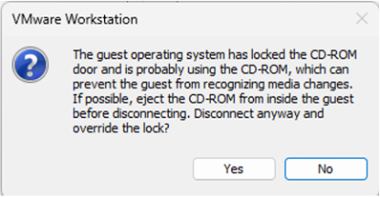
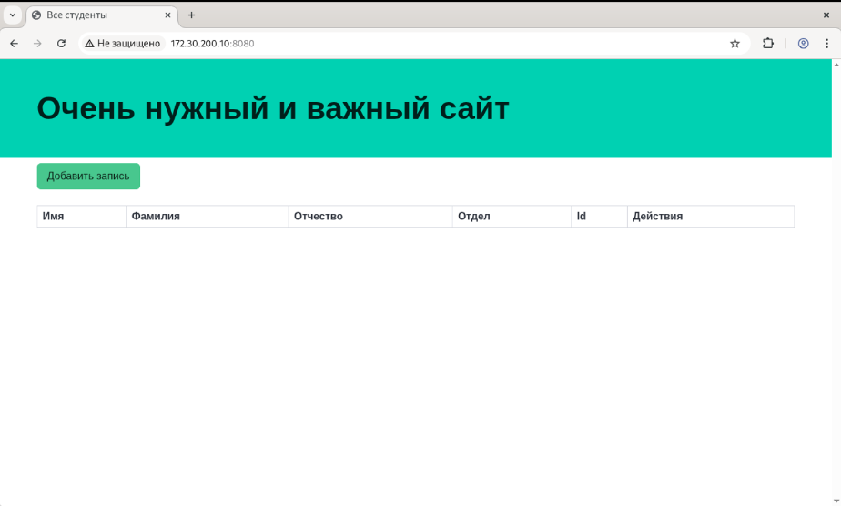
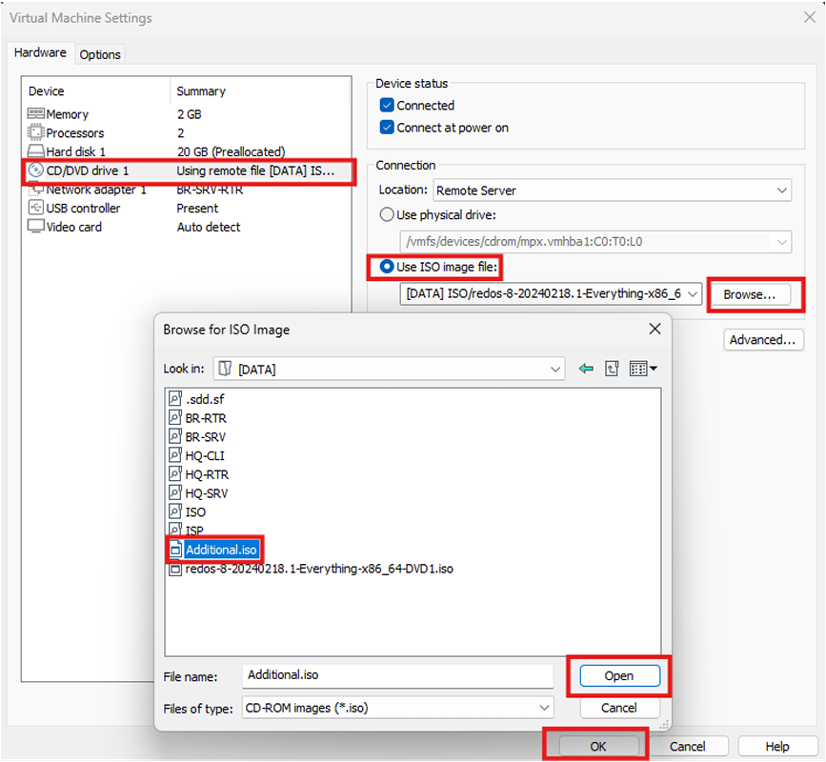
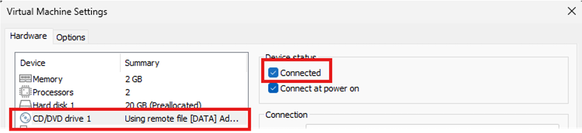
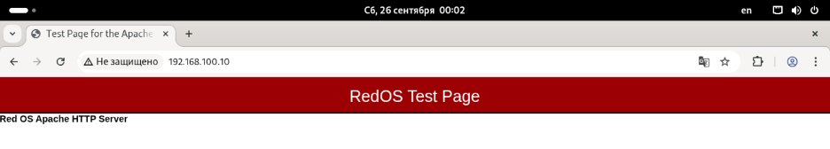
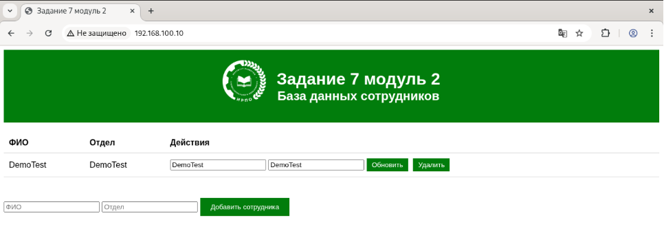
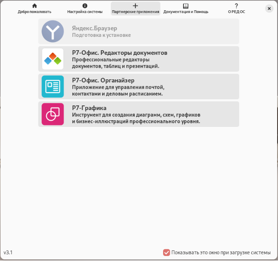

# МОДУЛЬ 2

br-srv:
```
krb5* samba*
ansible
docker-ce docker-compose
```

hq-srv:
```
nfs4-acl-tools exportfs
mariadb-server httpd php php-mysqlnd php-cli
```

hq-cli:
```
yandex-browser
```


---

## 1. Настройте установленный контроллер домена Samba DC на сервере BR-SRV

- Имя домена au-team.irpo
- Введите в созданный домен машину HQ-CLI
- Создайте 5 пользователей для офиса HQ: имена пользователей формата hquser№ (например hquser1, hquser2 и т.д.), политика паролей
    - Минимальная длина пароля 8 символов
    - Блокировка учётной записи после 5 неудачных попыток входа
- Создайте группу hq, введите в группу созданных пользователей
- Убедитесь, что пользователи группы hq имеют право аутентифицироваться на HQ-CLI
- Пользователи группы hq должны иметь возможность повышать привилегии для выполнения ограниченного набора команд: cat, grep, id. Запускать другие команды с повышенными привилегиями пользователи группы права не имеют.

### На HQ-SRV

```bash
systemctl restart named
```

### На BR-SRV

```bash
dnf install -y samba* krb5*
mv /etc/samba/smb.conf /etc/samba/smb.conf.bak
mv /etc/krb5.conf /etc/krb5.conf.bak
nano /etc/krb5.conf.d/crypto-policies
```

Изменяем файл следующим образом:

```ini
[libdefaults]
default_tgs_enctypes = длинная строка не трогать (скопированная)
default_tkt_enctypes = длинная строка не трогать (скопированная)
permitted_enctypes = длинная строка не трогать
```

Для этого ставим курсор на существующую строчку `permitted_enctypes`, нажимаем CTRL+K и три раза CTRL+U. После этого изменяем начало первых двух строчек.

Выходим из nano: нажимаем ctrl+x, затем y

```bash
samba-tool domain provision --use-rfc2307 --interactive
```

Жмём Enter 3 раза. Далее на моменте DNS backend пишем NONE. Затем указываем пароль администратора `P@ssw0rd`

```bash
cp /var/lib/samba/private/krb5.conf /etc/krb5.conf
nano /etc/krb5.conf
```

В realms добавляем kdc:

```text
kdc = br-srv.au-team.irpo
```

Выходим из nano: нажимаем ctrl+x, затем y

```bash
systemctl enable --now samba
```

Если запустить службы smb nmb winbind krb5kdc, то присоединить HQCLI к домену не получится. Решение - перезапуск BR-SRV

```bash
kinit administrator@AU-TEAM.IRPO
```

Задаем минимальную длину пароля 8 символов и порог блокировки 5 попыток:

```bash
samba-tool domain passwordsettings set --min-pwd-length=8 --account-lockout-threshold=5
```

Проверяем применившиеся политики:

```bash
samba-tool domain passwordsettings show
```

```bash
samba-tool group add hq
for i in {1..5}; do samba-tool user add hquser$i P@ssw0rd;samba-tool group addmembers hq hquser$i; done
samba-tool group listmembers hq
```

```text
[root@br-srv ~]# samba-tool group listmembers hq
hquser2
hquser1
hquser4
hquser5
hquser3
```

### На HQ-CLI

```bash
su -
echo "<ip-адрес br-srv> au-team.irpo" >> /etc/hosts
nano /etc/krb5.conf
```

Приводим файл к следующему виду:

```ini
[realms]
AU-TEAM.IRPO = {
    kdc = br-srv.au-team.irpo
    admin_server = br-srv.au-team.irpo
}

[domain_realm]
.au-team.irpo = AU-TEAM.IRPO
au-team.irpo = AU-TEAM.IRPO
```

Выходим из nano: нажимаем ctrl+x, затем y

```bash
realm join -U -v Administrator@AU-TEAM.IRPO
```

В конце добавления должна появиться надпись “Successfully enrolled machine in realm”

```bash
nano /etc/sssd/sssd.conf
```

Дописываем в подчёркнутой строчке `br-srv.` (как на скриншоте):

```ini
ad_server = br-srv.au-team.irpo
```

```bash
systemctl restart sssd
sss_cache -E
echo "%hq@au-team.irpo ALL=(ALL) NOPASSWD: /bin/cat, /bin/grep, /bin/id" >> /etc/sudoers
```

Проверяем:

```bash
id hquser1@AU-TEAM.IRPO
su - hquser1@AU-TEAM.IRPO
sudo cat /etc/hosts | grep au-team
id
```

---

## 2. Сконфигурируйте файловое хранилище на сервере HQ-SRV

- При помощи двух подключенных к серверу дополнительных дисков размером 1 Гб сконфигурируйте дисковый массив уровня 0
- Имя устройства – md0, при необходимости конфигурация массива размещается в файле /etc/mdadm.conf
- Создайте раздел, отформатируйте раздел, в качестве файловой системы используйте ext4
- Обеспечьте автоматическое монтирование в папку /raid

### На HQ-SRV

Проверяем наличие дисков командой. Должны быть sdb, sdc:

```bash
lsblk
```

```text
[root@hq-srv ~]# lsblk
NAME   MAJ:MIN RM  SIZE RO TYPE MOUNTPOINTS
sdb      8:16   0   1G  0 disk
sdc      8:32   0   1G  0 disk
```

Форматируем диски:

```bash
fdisk /dev/sdb
```

```text
g
n
(Enter 3 раза)
w
```

```bash
fdisk /dev/sdc
```

```text
g
n
(Enter 3 раза)
w
```

Должно получиться так:

```text
[root@hq-srv ~]# lsblk
NAME   MAJ:MIN RM  SIZE RO TYPE MOUNTPOINTS
sdb      8:16   0   1G  0 disk
└─sdb1   8:17   0 1022M 0 part
sdc      8:32   0   1G  0 disk
└─sdc1   8:33   0 1022M 0 part
```

```bash
mdadm --create /dev/md0 --level=0 --raid-device=2 /dev/sdb1 /dev/sdc1
```

Далее проверяем, у md0 в типе должно быть написано raid0:

```text
NAME   MAJ:MIN RM  SIZE RO TYPE  MOUNTPOINTS
sdb      8:16   0    1G  0 disk
└─sdb1   8:17   0 1022M  0 part
  └─md0  9:0    0    2G  0 raid0
sdc      8:32   0    1G  0 disk
└─sdc1   8:33   0 1022M  0 part
  └─md0  9:0    0    2G  0 raid0
```

```bash
mdadm --detail --scan --verbose >> /etc/mdadm.conf
mkfs.ext4 /dev/md0
mkdir /raid
nano /etc/fstab
```

В конец добавляем следующую строчку:

```text
/dev/md0	/raid	ext4	defaults	0	0
```

потом

```bash
systemctl daemon-reload
mount -a
df -h
```

Должна быть строчка с примонтированной директорией /raid:

```text
[root@hq-srv ~]# df -h
...
/dev/md0          2,0G          24K 1,9G            1% /raid
```

---

## 3. Настройте сервер сетевой файловой системы (nfs) на HQ-SRV

- В качестве папки общего доступа выберите /raid/nfs, доступ для чтения и записи исключительно для сети в сторону HQ-CLI
- На HQ-CLI настройте автомонтирование в папку /mnt/nfs
- Основные параметры сервера отметьте в отчёте

### На HQ-SRV

```bash
dnf install nfs4-acl-tools exportfs -y
mkdir /raid/nfs
chown nobody:nobody /raid/nfs
chmod 777 /raid/nfs
nano /etc/exports
```

Добавляем в него следующую строчку:

```text
/raid/nfs 192.168.200.0/28(rw)
```

Выходим из nano: нажимаем ctrl+x, затем y

```bash
exportfs -a
systemctl enable --now nfs-server
```

### Переходим на HQ-CLI

```bash
mkdir /mnt/nfs
nano /etc/fstab
```

Добавляем в конец следующую строчку:

```text
<ip-адрес hq-srv>:/raid/nfs	/mnt/nfs	nfs	auto	0	0
```

Результат:

```text
#
# /etc/fstab
# Created by anaconda on Wed Sep 16 10:46:48 2026
#
# Accessible filesystems, by reference, are maintained under '/dev/disk/'.
# See man pages fstab(5), findfs(8), mount(8) and/or blkid(8) for more info.
#
# After editing this file, run 'systemctl daemon-reload' to update systemd
# units generated from this file.
#
UUID=2b983fed-7fda-4960-acac-1d5176d8d5dc /      ext4    defaults        1 1
UUID=e1105e14-afe6-469a-bdb9-876068872edb /boot  ext4    defaults        1 2
UUID=0688e43e-970c-42d3-bfda-da3fbbadcbee none   swap    defaults        0 0
192.168.100.10:/raid/nfs        /mnt/nfs        nfs     auto    0       0
```

Выходим из nano: нажимаем ctrl+x, затем y

```bash
systemctl daemon-reload
mount -a
```

Проверяем с помощью команды `df -h` (должна появиться строка `<ip-адрес hq-srv>:/raid/nfs`):

```text
[root@hq-cli ~]# df -h
Файловая система         Размер Использовано  Дост Использовано% Смонтировано в
devtmpfs                   4,0M            0  4,0M            0% /dev
tmpfs                      2,0G            0  2,0G            0% /dev/shm
tmpfs                      784M         3,4M  780M            1% /run
/dev/sda4                   40G         9,4G   28G           26% /
tmpfs                      2,0G         8,0K  2,0G            1% /tmp
/dev/sda2                  974M         223M  685M           25% /boot
tmpfs                      392M          92K  392M            1% /run/user/1000
/dev/sr0                   5,7G         5,7G     0          100% /run/media/username/redos-DVD-x86_64-8
192.168.100.10:/raid/nfs   2,0G            0  1,9G            0% /mnt/nfs
[root@hq-cli ~]#
```

---

## 4. Настройте службу сетевого времени на базе сервиса chrony на маршрутизаторе ISP

- Вышестоящий сервер ntp на маршрутизаторе ISP - на выбор участника
- Стратум сервера - 5
- В качестве клиентов ntp настройте: HQ-SRV, HQ-CLI, BR-RTR, BR-SRV.

### На ISP

```bash
nano /etc/chrony.conf
```

Комментируем крайние три сервера и добавляем:

```text
local stratum 5
allow 0/0
hwtimestamp *
```

Результат:

```text
# Use public servers from the pool.ntp.org project.
# Please consider joining the pool (https://www.pool.ntp.org/join.html).
server ntp1.vniiftri.ru iburst
#server ntp2.vniiftri.ru iburst
#server ntp3.vniiftri.ru iburst
#server ntp4.vniiftri.ru iburst
local stratum 5
allow 0/0
hwtimestamp *
```

Выходим из nano: нажимаем ctrl+x, затем y

```bash
systemctl restart chronyd
chronyc sources
```

```text
[root@isp ~]# chronyc sources
MS Name/IP address         Stratum Poll Reach LastRx Last sample
===============================================================================
^* ntp1.vniiftri.ru              1   6    37    55   -102us[-2178us] +/-   10ms
[root@isp ~]# _
```

### На HQ-SRV, HQ-CLI, BR-RTR, BR-SRV

```bash
nano /etc/chrony.conf
```

Комментируем все сервера и добавляем созданный:

```text
server <ip-адрес isp ens34> iburst prefer
```

Результат:

```text
#server ntp1.vniiftri.ru iburst
#server ntp2.vniiftri.ru iburst
#server ntp3.vniiftri.ru iburst
#server ntp4.vniiftri.ru iburst
server 172.16.2.1 iburst prefer
```

Выходим из nano: нажимаем ctrl+x, затем y

```bash
systemctl restart chronyd
chronyc sources
```

```text
[root@hq-srv ~]# chronyc sources
MS Name/IP address         Stratum Poll Reach LastRx Last sample
===============================================================================
^* 172.16.2.1                    2   6    77    53    +75us[ +430us] +/- 9983us
[root@hq-srv ~]# _
```

---

## 5. Сконфигурируйте ansible на сервере BR-SRV

- Сформируйте файл инвентаря, в инвентарь должны входить HQ-SRV, HQ CLI, HQ-RTR и BR-RTR
- Рабочий каталог ansible должен располагаться в /etc/ansible
- Все указанные машины должны без предупреждений и ошибок отвечать pong на команду ping в ansible посланную с BR-SRV.

### На BR-SRV

```bash
dnf install ansible
mkdir /etc/ansible
nano /etc/ansible/demo.ini
```

Пишем в файл:

```ini
[HQ_SRV]
<ip-адрес hq-srv> ansible_user=sshuser ansible_port=2027
[HQ_CLI]
<ip-адрес hq-cli> ansible_user=username
[HQ_RTR]
<ip-адрес hq-rtr> ansible_user=net_admin
[BR_RTR]
<ip-адрес br-rtr> ansible_user=net_admin
```

Выходим из nano: нажимаем ctrl+x, затем y

```bash
ssh-keygen -t rsa
```

Жмём Enter всегда до конца выполнения команды

Далее копируем ключи. На вопрос с сохранением отпечатка пишем yes, все пароли – `P@ssw0rd`

```bash
ssh-copy-id -p 2027 sshuser@<ip-адрес hq-srv>
ssh-copy-id username@<ip-адрес hq-cli>
ssh-copy-id net_admin@<ip-адрес hq-rtr>
ssh-copy-id net_admin@<ip-адрес br-rtr>
```

Составляем конфигурационный файл:

```bash
nano /etc/ansible/ansible.cfg
```

```ini
[defaults]
Inventory = /etc/ansible/demo.ini
ask_pass = False
host_key_checking = False
interpreter_python=/usr/bin/python
```

Выходим из nano: нажимаем ctrl+x, затем y

```bash
ansible -m ping all
```

---

## 6. Разверните веб приложение в docker на сервере BR-SRV

- Средствами docker должен создаваться стек контейнеров с веб приложением и базой данных
- Используйте образы site_latest и mariadb_latest, располагающиеся в директории docker в образе Additional.iso
- В качестве docker файла используйте файл compose.yaml, который располагается в образе Additional.iso
- Приложение testapp, развёрнутое через docker, доступно для внешних подключений через порт 8080

### На BR-SRV

Перед развертыванием выполняем монтирование ISO образа с необходимыми Docker-образами. Для этого переходим через VMWare WorkStation в настройки виртуальной машины. Там выбираем CD/DVD driver 1 > Use ISO image file > Browse > Additional.iso > Open > OK.


Выходит уведомление, соглашаемся:

_

После этого заново заходим в настройки BR-SRV, выбираем CD/DVD driver 1 > Connected > OK.


### На BR-SRV

```bash
mount /dev/cdrom /mnt
dnf install docker-ce docker-compose -y
systemctl enable --now docker
docker --version
docker load < /mnt/docker/site_latest.tar
docker load < /mnt/docker/mariadb_latest.tar
```

Проверка:

```bash
docker images
```

```text
[root@br-srv ~]# docker images
IMAGE              ID             DISK USAGE   CONTENT SIZE   EXTRA
mariadb:10.11      bc52d24721da        327MB             0B
site:latest        015b4b821098        353MB             0B
[root@br-srv ~]#
```

```bash
cp /mnt/docker/compose.yaml .
docker-compose -f compose.yaml up -d
```

### На HQ-CLI

Открываем браузер и заходим на `<ip-адрес br-srv>:8080`



---

## 7. Разверните веб приложение на сервере HQ-SRV

- Используйте веб-сервер apache
- В качестве системы управления базами данных используйте mariadb
- Файлы веб приложения и дамп базы данных находятся в директории web образа Additional.iso
- Выполните импорт схемы и данных из файла dump.sql в базу данных webdb
- Создайте пользователя web с паролем P@ssw0rd и предоставьте ему права доступа к этой базе данных
- Файлы index.php и файл logo.png скопируйте в корневой каталог сайта
- В файле index.php укажите правильные учётные данные для подключения к БД
- Запустите веб сервер и убедитесь в работоспособности приложения
- Основные параметры отметьте в отчёте

### На HQ-SRV

Перед развертыванием выполняем монтирование ISO образа с необходимыми Docker-образами. Для этого переходим через VMWare WorkStation в настройки виртуальной машины. Там выбираем CD/DVD driver 1 > Use ISO image file > Browse > Additional.iso > Open > OK.



Выходит уведомление, соглашаемся:


После этого заново заходим в настройки BR-SRV, выбираем CD/DVD driver 1 > Connected > OK.



### На HQ-SRV

```bash
mount /dev/cdrom /mnt
dnf install mariadb-server httpd php php-mysqlnd php-cli -y
systemctl enable --now mariadb httpd
```

Для проверки на hq-cli открываем в браузере `<ip-адрес hq-srv>`



```bash
mysql_secure_installation
```

Ответы на вопросы:

```text
P@ssw0rd
n
n
y
y
y
y
```

```bash
mysql -u root -p
P@ssw0rd
```

```sql
CREATE USER 'web'@'localhost' IDENTIFIED BY 'P@ssw0rd';
CREATE DATABASE webdb DEFAULT CHARACTER SET utf8;
GRANT ALL PRIVILEGES ON webdb.* TO 'web'@'localhost';
flush privileges;
\q
```

```bash
mysql -u root -p webdb < /mnt/web/dump.sql
cp /mnt/web/index.php /var/www/html
cp /mnt/web/logo.png /var/www/html
nano /var/www/html/index.php
```

Меняем значения как на скриншоте:

```php
<?php
$servername = "localhost";
$username = "web";
$password = "P@ssw0rd";
$dbname = "webdb";
```

Выходим из nano: нажимаем ctrl+x, затем y

```bash
systemctl restart httpd
```

На hq-cli снова открываем в браузере `<ip-адрес hq-srv>`



---

## 8. На маршрутизаторах сконфигурируйте статическую трансляцию портов

- Пробросьте порт 8080 в порт приложения testapp BR-SRV на маршрутизаторе BR-RTR, для обеспечения работы приложения testapp извне
- Пробросьте порт 8080 в порт веб приложения на HQ-SRV на маршрутизаторе HQ-RTR, для обеспечения работы веб приложения извне
- Пробросьте порт 2027 на маршрутизаторе HQ-RTR в порт 2027 сервера HQ-SRV, для подключения к серверу по протоколу ssh из внешних сетей
- Пробросьте порт 2027 на маршрутизаторе BR-RTR в порт 2027 сервера BR-SRV, для подключения к серверу по протоколу ssh из внешних сетей

### На BR-RTR

```bash
iptables -t nat -A PREROUTING -p tcp -m tcp -d <ip-адрес br-rtr ens33> --dport 8080 -j DNAT --to-destination <ip-адрес br-srv>:8080
iptables -t nat -A PREROUTING -p tcp -m tcp -d <ip-адрес br-rtr ens33> --dport 2027 -j DNAT --to-destination <ip-адрес br-srv>:2027
iptables-save > /etc/sysconfig/iptables
```

На hq-cli в браузере открываем `<ip-адрес br-rtr ens33>:8080`, должен открыться сайт как в задании 6.

Пробуем подключиться по ssh, должно подключить к br-srv:

```bash
ssh -l sshuser <ip-адрес br-rtr ens33> -p 2027
```


### На HQ-RTR

```bash
iptables -t nat -A PREROUTING -p tcp -m tcp -d <ip-адрес hq-rtr> --dport 8080 -j DNAT --to-destination <ip-адрес hq-srv>:80
iptables -t nat -A PREROUTING -p tcp -m tcp -d <ip-адрес hq-rtr> --dport 2027 -j DNAT --to-destination <ip-адрес hq-srv>:2027
iptables-save > /etc/sysconfig/iptables
```

На hq-cli в браузере открываем `<ip-адрес hq-rtr ens33>:8080`, должен открыться сайт как в задании 7.

Пробуем подключиться по ssh, должно подключить к hq-srv:

```bash
ssh -l sshuser <ip-адрес hq-rtr ens33> -p 2027
```

---

## 9. Удобным способом установите приложение Яндекс Браузер на HQ-CLI

- Установку браузера отметьте в отчёте.

### На HQ-CLI

Заходим в «Окно настройки РЕДОС», переходим во вкладку «Партнерские приложения» и нажимаем на Яндекс браузер. После загрузки нажимаем на клавишу WIN и выбираем «Другие приложения». Переходим на вторую страницу и запускаем браузер.


